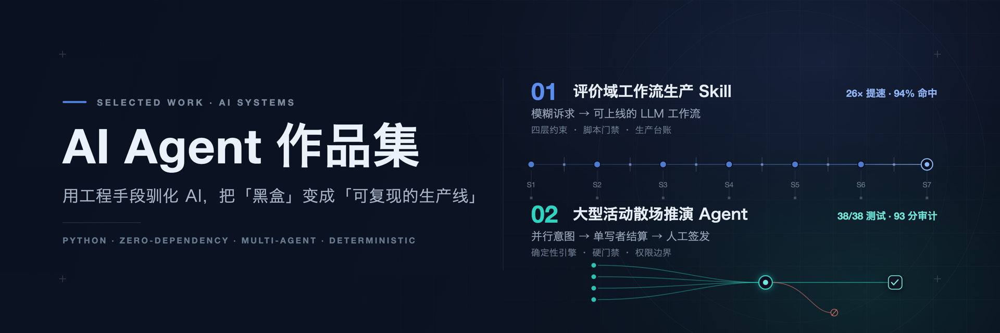
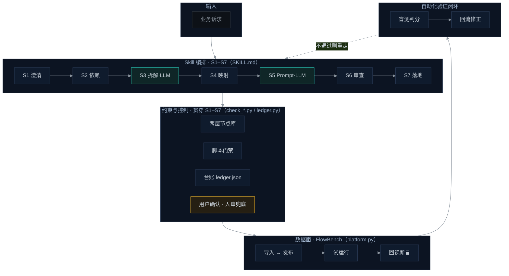
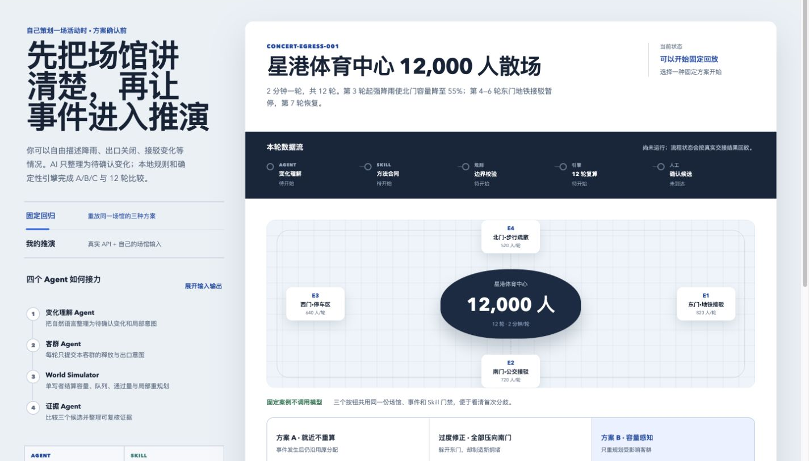
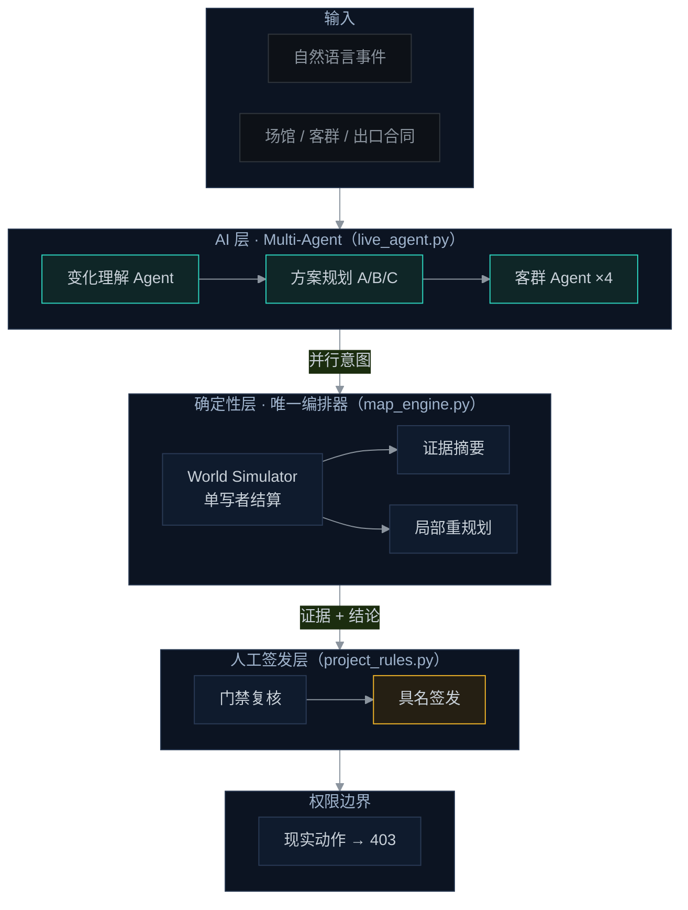

<div align="center">
  
</div>

我关注 **AI Agent 与 LLM 工作流**方向：在模型能力本身不可靠的前提下，如何把一个模糊需求，收敛成边界清晰、可运行、可验证的 AI 产品系统。

我在意的不是「把模型用起来」，而是三个判断——它该用在哪一步、边界划在哪里、以及怎么证明它做对了。下面两个项目是同一个问题的两种解法。

## 项目导航

<div align="center">
  <table border="0" cellspacing="8" cellpadding="0" width="100%">
    <tr>
      <td width="50%" valign="top" style="background-color:#0f1b2d; border:1px solid #2a3a55; border-radius:12px; padding:20px 22px; text-align:left;">
        <div style="font-size:12px; font-weight:700; letter-spacing:2px; color:#5b8def;">01</div>
        <div style="font-size:18px; font-weight:700; color:#e6edf3; margin-top:6px;">评价域工作流生产 Skill</div>
        <div style="font-size:13px; color:#8b949e; margin-top:8px; line-height:1.6;">把模糊的业务诉求，自动生产成可上线、可复现的 LLM 工作流</div>
        <div style="margin-top:12px; line-height:2.2;">
          <span style="background-color:#1f2937; color:#9fb3cc; border-radius:6px; padding:2px 9px; font-size:11px;">Skill 工程化</span>
          <span style="background-color:#1f2937; color:#9fb3cc; border-radius:6px; padding:2px 9px; font-size:11px;">脚本门禁</span>
          <span style="background-color:#1f2937; color:#9fb3cc; border-radius:6px; padding:2px 9px; font-size:11px;">两层节点库</span>
          <span style="background-color:#1f2937; color:#9fb3cc; border-radius:6px; padding:2px 9px; font-size:11px;">盲测验证</span>
        </div>
        <div style="margin-top:14px;">
          <a href="review-workflow-builder/README.md" style="color:#5b8def; font-weight:600; font-size:13px; text-decoration:none;">查看项目详情 →</a>
        </div>
      </td>
      <td width="50%" valign="top" style="background-color:#0f1b2d; border:1px solid #2a3a55; border-radius:12px; padding:20px 22px; text-align:left;">
        <div style="font-size:12px; font-weight:700; letter-spacing:2px; color:#2fd3c0;">02</div>
        <div style="font-size:18px; font-weight:700; color:#e6edf3; margin-top:6px;">大型活动散场推演 Agent</div>
        <div style="font-size:13px; color:#8b949e; margin-top:8px; line-height:1.6;">回答「一群人同时离场，方案到底成不成立」的可签署推演台</div>
        <div style="margin-top:12px; line-height:2.2;">
          <span style="background-color:#1f2937; color:#9fb3cc; border-radius:6px; padding:2px 9px; font-size:11px;">Multi-Agent 协作</span>
          <span style="background-color:#1f2937; color:#9fb3cc; border-radius:6px; padding:2px 9px; font-size:11px;">确定性仿真</span>
          <span style="background-color:#1f2937; color:#9fb3cc; border-radius:6px; padding:2px 9px; font-size:11px;">具名签发</span>
          <span style="background-color:#1f2937; color:#9fb3cc; border-radius:6px; padding:2px 9px; font-size:11px;">可追溯证据</span>
        </div>
        <div style="margin-top:14px;">
          <a href="event-egress-agent/README.md" style="color:#2fd3c0; font-weight:600; font-size:13px; text-decoration:none;">查看项目详情 →</a>
        </div>
      </td>
    </tr>
  </table>
</div>

---

## <span style="color:#5b8def">01</span> · 评价域工作流生产 Skill

**业务问题。** 评价域已有不少 AI 工作流带来业务价值，但「生产工作流本身」仍靠少数人手工完成——单条约 25.75 人日，门槛高、方法论内隐、迭代贵。更根本的矛盾是：AI 天生不可信（会想象节点、跳步、假称完成），而工程交付要求稳定可复现。

**核心成果。**

<div align="center">
  <table border="0" cellspacing="8" cellpadding="0" width="100%">
    <tr>
      <td align="center" width="25%" style="background-color:#0f1b2d; border:1px solid #2a3a55; border-radius:10px; padding:16px 8px;">
        <div style="font-size:24px; font-weight:700; color:#5b8def; line-height:1.1;">26×</div>
        <div style="font-size:12px; color:#8b949e; margin-top:6px;">生产提速<br/>25.75 → 2 人日</div>
      </td>
      <td align="center" width="25%" style="background-color:#0f1b2d; border:1px solid #2a3a55; border-radius:10px; padding:16px 8px;">
        <div style="font-size:24px; font-weight:700; color:#5b8def; line-height:1.1;">94%</div>
        <div style="font-size:12px; color:#8b949e; margin-top:6px;">盲测节点命中率</div>
      </td>
      <td align="center" width="25%" style="background-color:#0f1b2d; border:1px solid #2a3a55; border-radius:10px; padding:16px 8px;">
        <div style="font-size:24px; font-weight:700; color:#5b8def; line-height:1.1;">0</div>
        <div style="font-size:12px; color:#8b949e; margin-top:6px;">想象节点</div>
      </td>
      <td align="center" width="25%" style="background-color:#0f1b2d; border:1px solid #2a3a55; border-radius:10px; padding:16px 8px;">
        <div style="font-size:24px; font-weight:700; color:#5b8def; line-height:1.1;">100%</div>
        <div style="font-size:12px; color:#8b949e; margin-top:6px;">稳定执行率</div>
      </td>
    </tr>
  </table>
</div>

预埋标准答案盲测（封存标准答案、只喂原始诉求、跑完开封逐节点判分）：命中率 31%–69% → **94%**，想象节点 1.7/次 → **0**，稳定执行率 83% → **100%**。5 条真实任务的完整产物链，4 条在 FlowBench 跑通（如「评价质量自动审核」19 节点 / 6 个 LLM prompt / 5 用例，含一次接口 500 的错误注入与节点级定位）；第 5 条在流程拆解阶段被开销预估表拦下，作为反例保留。

**Demo 展示。** 自建 FlowBench 工作流平台，导入 demo 脚本即可发布、试运行并回读节点级结果：

```
cd review-workflow-builder/platform && python platform.py   # → http://127.0.0.1:8787
```

### AI 技术架构



**关键产品决策。**

- **产品定义**：与其做「更强的 Prompt」，不如把生产过程变成受约束的系统——用固定七步流程（S1–S7）替代一次性生成，每一步必须产出可被校验的文件。
- **技术取舍**：模型只承担「流程推理（S3）」与「Prompt 生成（S5）」两个工位，其余靠节点库检索与规则；每个 LLM 节点必须写出「非 LLM 不可」的理由，能判的交给代码或条件分支。
- **约束机制**：两层节点库保证节点必须有出处（想象节点归零）；门禁脚本 + 台账把推进权交给脚本而非模型。

**详细资料入口。** [项目 README](review-workflow-builder/README.md) · [Skill 主控](review-workflow-builder/skill/SKILL.md) · [测试诉求集（盲测口径）](review-workflow-builder/skill/test-scenarios.md) · [平台定义](review-workflow-builder/platform/平台定义文档.md) · [跑通报告样例](review-workflow-builder/runs/评价质量自动审核/08-跑通报告.md)

---

## <span style="color:#2fd3c0">02</span> · 大型活动散场推演 Agent

**业务问题。** 普通路线推荐回答「一个人怎么走」；散场是**多人共享有限出口与接驳资源**的问题，容量还会变（降雨）、会临时关闭。旧静态方案事件后无法响应，人工改表只看眼前问题、看不到风险转移。这类方案真正要交付的，是**可比较、可追溯、可签字**的证据。

**核心成果。** 固定案例 12,000 人 / 4 客群 / 4 出口 / 12 轮（每轮 2 分钟；第 3 轮降雨、第 4–6 轮东门关闭）：

<div align="center">
  <table border="0" cellspacing="8" cellpadding="0" width="100%">
    <tr>
      <td align="center" width="25%" style="background-color:#0f1b2d; border:1px solid #2a3a55; border-radius:10px; padding:16px 8px;">
        <div style="font-size:24px; font-weight:700; color:#2fd3c0; line-height:1.1;">0</div>
        <div style="font-size:12px; color:#8b949e; margin-top:6px;">溢出轮次（B 方案）</div>
      </td>
      <td align="center" width="25%" style="background-color:#0f1b2d; border:1px solid #2a3a55; border-radius:10px; padding:16px 8px;">
        <div style="font-size:24px; font-weight:700; color:#2fd3c0; line-height:1.1;">16 分钟</div>
        <div style="font-size:12px; color:#8b949e; margin-top:6px;">B 方案清场用时</div>
      </td>
      <td align="center" width="25%" style="background-color:#0f1b2d; border:1px solid #2a3a55; border-radius:10px; padding:16px 8px;">
        <div style="font-size:24px; font-weight:700; color:#2fd3c0; line-height:1.1;">93 分</div>
        <div style="font-size:12px; color:#8b949e; margin-top:6px;">独立审计（78 → 93）</div>
      </td>
      <td align="center" width="25%" style="background-color:#0f1b2d; border:1px solid #2a3a55; border-radius:10px; padding:16px 8px;">
        <div style="font-size:24px; font-weight:700; color:#2fd3c0; line-height:1.1;">8 / 8</div>
        <div style="font-size:12px; color:#8b949e; margin-top:6px;">硬门槛</div>
      </td>
    </tr>
  </table>
</div>

- **A 就近出口** — 完成 10,280 / 12,000，最高密度 2.767，溢出 9 轮 → 不可签发
- **B 韧性均衡** — 完成 12,000 / 12,000，16 分钟，最高密度 0.476，0 溢出 → **通过门禁，可提交复核**
- **C 运力优先** — 完成 12,000 / 12,000，最高密度 1.15，溢出 1 轮 → 不可签发

单元测试 38 / 38；Skill 行为评测 4 / 4；独立审计 78 → **93 分、8/8 硬门槛**（含一次受控修复）；桌面 / 移动无溢出、控制台 error/warning = 0、越权动作返回 403。

**Demo 展示。** 本地可运行的「散场预演台」：固定回归回放 A/B/C 三套方案，或用自然语言描述事件走真实模型生成草案、再由确定性引擎复算：

```
cd event-egress-agent && python3 server.py --port 8927   # → http://127.0.0.1:8927
```

<div align="center">
  
</div>

### AI 技术架构



**关键产品决策。**

- **产品定义**：先把「谁在什么时候做什么」定死——活动方案负责人负责核对、运行 A/B/C、比较并选择；有权限的责任人负责复核与具名签发。系统只给判断与证据，不替人决定。
- **技术取舍**：模型只做理解（自然语言 → 变化草案）与表达（客群出行意图），容量、队列、完成数全部由 `map_engine` 确定性结算；四个客群 Agent 只提交局部意图、不改写公共容量。
- **责任边界**：任何现实动作（封路 / 调度 / 地图写回 / 公众引导）一律 403 拒绝；签发必须具名（姓名 + 处理说明）。

**详细资料入口。** [项目 README](event-egress-agent/README.md) · [测试报告](event-egress-agent/qa/TEST-REPORT.md) · [独立评测与修复报告](event-egress-agent/qa/FINAL-AUDIT.md) · [审计证据](event-egress-agent/qa/final-audit-evidence.json) · [关键交互日志](event-egress-agent/docs/关键交互日志.md)

---

## AI 产品经理能力地图

| 能力 | 项目一 · 评价域工作流 | 项目二 · 散场推演 |
|---|---|---|
| **业务洞察** | 识别「生产工作流本身」才是瓶颈（25.75 人日、少数人承接） | 识别散场是「多人共享容量」问题，而非单一路线推荐 |
| **产品定义** | 把一次性生成重定义为受约束的七步生产线 | 先定死「谁在何时做什么」，系统只给证据、不替人决定 |
| **技术方案取舍** | 非 LLM 不可才用 LLM，其余交给代码与规则 | 模型只做理解 / 表达，计算交给确定性引擎 |
| **AI Coding** | 先写接口契约与盲测诉求集 → 交 Coding Agent → 门禁脚本回读 | 五类合同先行，消除 Coding Agent 自行补规则的歧义 |
| **效果验证** | 预埋标准答案盲测：94% 命中 / 0 想象节点 / 100% 稳定 | 38 单元测试 + 4 行为评测 + 93 分独立审计（8/8 硬门槛） |

> 构建过程统一为「先写合同与输入包 → 交给 Coding Agent 实现 → 用测试与审计回读」。技术底座：Python（后端以标准库为主，项目一零第三方依赖）+ 原生 HTML / JS；项目一自建零依赖的 FlowBench 工作流平台（导入 / 发布 / 试运行 / 回读）。

---

## 说明

两个项目均为个人演示项目，运行在本地，业务数据为 mock / 仿真数据，不涉及任何真实公司信息。上文出现的耗时、命中率、审计分数等均来自项目内公开产物中记录的实测或评测结果；尚未实现的能力不作承诺。

<div align="center">
  <sub>用工程手段驯化 AI，把「黑盒」变成「可复现的生产线」。</sub>
</div>
